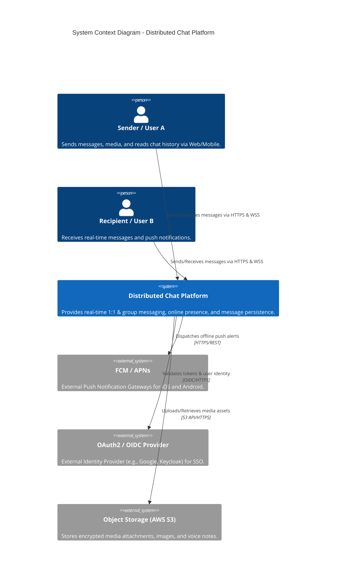
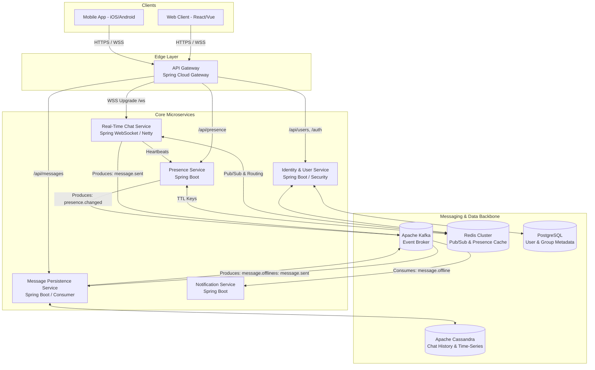
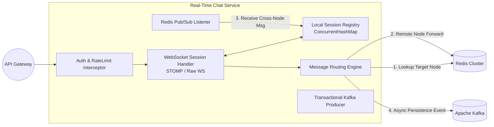
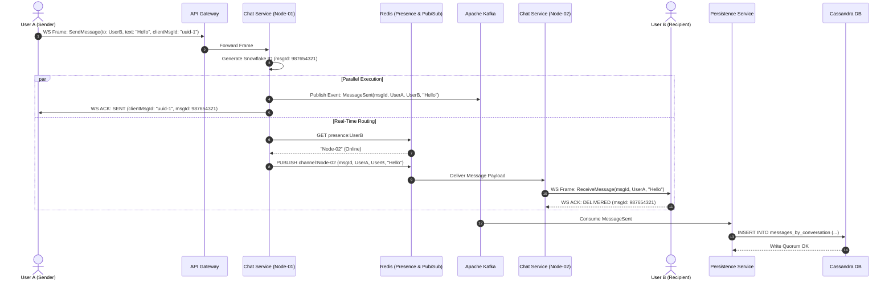

# Enterprise Distributed Chat Platform

A scalable, real-time, event-driven distributed messaging platform built on a Java/Spring Boot microservices architecture. This document outlines the High-Level Design (HLD), Low-Level Design (LLD) via the C4 Model, component specifications, end-to-end workflows, and architectural design patterns.

---

## Table of Contents
1. [Architecture Overview (The C4 Model)](#1-architecture-overview-the-c4-model)
   - [Level 1: System Context Diagram](#level-1-system-context-diagram)
   - [Level 2: Container Diagram (HLD)](#level-2-container-diagram-hld)
   - [Level 3: Component Diagram (LLD)](#level-3-component-diagram-lld)
   - [Level 4: Code Level (Class & Package Structure)](#level-4-code-level-class--package-structure)
2. [Microservices Deep-Dive (6-Parameter Matrix)](#2-microservices-deep-dive-6-parameter-matrix)
   - [API Gateway & Edge Service](#21-api-gateway--edge-service)
   - [Identity & User Service](#22-identity--user-service)
   - [Real-Time Chat & WebSocket Service](#23-real-time-chat--websocket-service)
   - [Message Persistence & History Service](#24-message-persistence--history-service)
   - [Presence & Session Service](#25-presence--session-service)
   - [Push Notification Service](#26-push-notification-service)
3. [End-to-End Workflows & Inter-Service Communication](#3-end-to-end-workflows--inter-service-communication)
   - [Service Relationships & Communication Matrix](#31-service-relationships--communication-matrix)
   - [Workflow A: Connection Establishment & Presence Sync](#32-workflow-a-connection-establishment--presence-sync)
   - [Workflow B: Real-Time 1-on-1 & Group Messaging](#33-workflow-b-real-time-1-on-1--group-messaging)
   - [Workflow C: Offline Delivery & Push Notifications](#34-workflow-c-offline-delivery--push-notifications)
4. [Design Patterns Implemented](#4-design-patterns-implemented)
   - [Microservice Architectural Patterns](#41-microservice-architectural-patterns)
   - [Java & Spring Boot Design Patterns](#42-java--spring-boot-design-patterns)

---

## 1. Architecture Overview (The C4 Model)

To provide clarity across all stakeholders—from executive leadership to core developers—the architecture is documented using **The Four C's (Context, Containers, Components, and Code)**.

### Level 1: System Context Diagram
At the highest level of abstraction, the Chat Platform acts as a central communication hub connecting end-users across multiple client interfaces while integrating with external identity and notification providers.



---

### Level 2: Container Diagram (HLD)
Zooming into the platform boundary reveals the independently deployable microservices, stateful datastores, caching layers, and the asynchronous event backbone.



---

### Level 3: Component Diagram (LLD)
Focusing on the **Real-Time Chat Service** (the most critical stateful-edge component), the internal architecture separates protocol handling, routing, and event publishing.



---

### Level 4: Code Level (Class & Package Structure)
The codebase enforces **Hexagonal Architecture (Ports & Adapters)** within each microservice to isolate domain logic from framework and infrastructure dependencies.

```text
com.chatplatform.chatservice
├── domain/                         # Pure Java business logic (Zero framework dependencies)
│   ├── model/                      # Entities & Value Objects (Message, Conversation, Session)
│   ├── port/
│   │   ├── in/                     # Use Case Interfaces (SendMessageUseCase, RouteEventUseCase)
│   │   └── out/                    # Outbound Interfaces (MessageBrokerPort, SessionCachePort)
│   └── service/                    # Domain Services implementing Use Cases
├── application/                    # Orchestration, DTOs, and Mappers
│   ├── dto/                        # Inbound/Outbound Payloads (ChatMessageDTO, AckDTO)
│   └── mapper/                     # MapStruct interfaces
└── infrastructure/                 # Framework & External Adapters
    ├── adapter/
    │   ├── in/websocket/           # WebSocketControllers, HandshakeInterceptors
    │   ├── in/redis/               # RedisMessageSubscriber
    │   └── out/kafka/              # KafkaMessagePublisher
    └── config/                     # Spring Security, ThreadPool, Resilience4j configs
```

---

## 2. Microservices Deep-Dive (6-Parameter Matrix)

### 2.1 API Gateway & Edge Service

| Parameter | Detailed Specification |
| :--- | :--- |
| **1. Primary Purpose & Key Responsibilities** | Acts as the single entry point for all client traffic. Handles TLS termination, JWT signature verification, dynamic service routing, WebSocket protocol upgrades (`HTTP 101`), cross-cutting rate limiting, and request correlation ID injection (`X-Correlation-ID`). |
| **2. Measuring Success (KPIs)** | • **Gateway Overhead Latency:** $< 5\text{ ms}$ (p99)<br>• **HTTP 5xx Error Rate:** $< 0.01\%$<br>• **Rate-Limit Accuracy:** $99.9\%$ enforcement accuracy<br>• **TLS Handshake Time:** $< 30\text{ ms}$ |
| **3. Data Flow, Response Times & Failure Impact** | • **Data Flow:** `Client -> Load Balancer -> API Gateway -> Downstream Microservice`.<br>• **Response Times:** REST proxy p95 $\le 15\text{ ms}$; WebSocket handshake $\le 50\text{ ms}$.<br>• **Failure Impact:** **Critical (Total Outage).** If the gateway fails, external clients cannot reach any internal service. Mitigated via multi-AZ active-active deployment behind an AWS ALB/NLB. |
| **4. Technologies, Advantages & Limitations** | • **Tech:** Spring Cloud Gateway (Project Reactor / Netty), Redis (Token Bucket Rate Limiter), Resilience4j.<br>• **Advantages:** Non-blocking reactive I/O handles tens of thousands of concurrent connections with minimal threads.<br>• **Limitations:** Debugging reactive stack traces is complex; long-lived WebSocket connections require careful idle-timeout tuning on upstream load balancers. |
| **5. Scalability & Performance Targets** | • **Scaling Strategy:** Horizontal Pod Autoscaling (HPA) triggered at $65\%$ CPU or active connection thresholds.<br>• **Targets:** $50,000$ REST RPS and $250,000$ concurrent proxied WebSocket tunnels per cluster. |
| **6. Security, Reliability & Compliance** | • **Security:** Enforces TLS 1.3, validates RS256 JWT tokens at the edge, strips internal headers, and blocks DDoS via IP/User token-bucket rate limiting.<br>• **Reliability:** Circuit breakers isolate failing downstream services to prevent thread/memory exhaustion. |

---

### 2.2 Identity & User Service

| Parameter | Detailed Specification |
| :--- | :--- |
| **1. Primary Purpose & Key Responsibilities** | Manages user registration, authentication, OAuth2/OIDC federation, JWT issuance/refresh rotation, user profile metadata, contact lists, and group membership/ACL (Access Control Lists). |
| **2. Measuring Success (KPIs)** | • **Auth Token Issuance Latency:** $< 80\text{ ms}$ (p95)<br>• **Profile Lookup Cache Hit Ratio:** $> 95\%$<br>• **Auth Availability:** $99.99\%$ |
| **3. Data Flow, Response Times & Failure Impact** | • **Data Flow:** `Gateway -> Identity Service -> Redis (Cache) / PostgreSQL (Primary DB)`. Publishes `user.updated` events to Kafka.<br>• **Response Times:** Cached profile reads $< 10\text{ ms}$; Login/Token generation $< 100\text{ ms}$ (due to BCrypt/Argon2 hashing).<br>• **Failure Impact:** **High.** New logins and new WebSocket handshakes fail. Existing authenticated WebSocket sessions remain operational until token expiration. |
| **4. Technologies, Advantages & Limitations** | • **Tech:** Spring Boot 3, Spring Security, PostgreSQL, Redis, Flyway (DB Migrations).<br>• **Advantages:** Strong ACID guarantees for user credentials, roles, and group permissions.<br>• **Limitations:** Vertical database write bottleneck during massive user onboarding spikes; requires read-replicas for heavy contact-list queries. |
| **5. Scalability & Performance Targets** | • **Scaling Strategy:** Stateless horizontal scaling; PostgreSQL read-replicas for profile lookups.<br>• **Targets:** $5,000$ authentication/profile RPS with sub-100ms p99 latency. |
| **6. Security, Reliability & Compliance** | • **Security:** Passwords hashed with Argon2id; short-lived Access Tokens ($15\text{ min}$) with rotating Refresh Tokens stored in HttpOnly cookies/secure storage.<br>• **Compliance:** GDPR-compliant soft-delete and PII encryption at rest (AES-256) and right-to-be-forgotten cascading anonymization. |

---

### 2.3 Real-Time Chat & WebSocket Service

| Parameter | Detailed Specification |
| :--- | :--- |
| **1. Primary Purpose & Key Responsibilities** | Maintains persistent bi-directional WebSocket connections with active clients. Validates incoming message payloads, assigns monotonic sequence IDs (Snowflake ID), routes messages to recipients' active server nodes via Redis Pub/Sub, and publishes messages to Kafka for durable storage. |
| **2. Measuring Success (KPIs)** | • **End-to-End Message Delivery Latency (Online):** $< 50\text{ ms}$ (p99)<br>• **Active Connection Drop Rate:** $< 0.05\%$ per hour<br>• **Message Throughput:** Messages routed per second per node |
| **3. Data Flow, Response Times & Failure Impact** | • **Data Flow:** `Client -> WS Handler -> Snowflake ID Gen -> Kafka (Async Persist) & Redis Pub/Sub -> Target WS Node -> Recipient Client`.<br>• **Response Times:** Server-side processing $< 8\text{ ms}$ per message.<br>• **Failure Impact:** **Medium-High.** Failure of a single node disconnects only the users pinned to that pod; clients immediately reconnect via exponential backoff to healthy nodes with zero message loss (via Kafka/Cassandra sync). |
| **4. Technologies, Advantages & Limitations** | • **Tech:** Spring WebSocket / Netty, Redis Pub/Sub, Apache Kafka Producer, Snowflake Distributed ID Generator.<br>• **Advantages:** Ultra-low latency push delivery; Snowflake IDs guarantee time-ordered sorting without database coordination.<br>• **Limitations:** Stateful nature complicates deployments—requires graceful connection draining (`SIGTERM` handling) during rolling updates to prevent thundering-herd reconnections. |
| **5. Scalability & Performance Targets** | • **Scaling Strategy:** Horizontal scaling based on active WebSocket file descriptors and JVM Direct Memory usage.<br>• **Targets:** $100,000$ concurrent persistent connections per node; $25,000$ messages/sec per node. |
| **6. Security, Reliability & Compliance** | • **Security:** Validates channel/group membership before accepting frames; payload sanitization against XSS; frame size limits ($64\text{ KB}$ max text frame).<br>• **Reliability:** Implements application-level ACKs (`SENT`, `DELIVERED`, `READ`) and idempotency keys (`client_msg_id`) to prevent duplicate deliveries on network retries. |

---

### 2.4 Message Persistence & History Service

| Parameter | Detailed Specification |
| :--- | :--- |
| **1. Primary Purpose & Key Responsibilities** | Consumes message events from Kafka to durably store chat histories, serves paginated historical message queries via REST, manages message states (edited, soft-deleted, read receipts), and detects offline recipients to trigger push notifications. |
| **2. Measuring Success (KPIs)** | • **Write Durability:** $99.999\%$ (Zero acknowledged message loss)<br>• **History Fetch Latency (Last 50 messages):** $< 35\text{ ms}$ (p95)<br>• **Kafka Consumer Lag:** $< 500$ messages under peak load |
| **3. Data Flow, Response Times & Failure Impact** | • **Data Flow:** `Kafka (message.sent) -> Batch Consumer -> Cassandra (Write) -> Check Presence -> Kafka (message.offline)`.<br>• **Response Times:** Async write batch $< 15\text{ ms}$; Historical pagination REST call $< 40\text{ ms}$.<br>• **Failure Impact:** **Low-Medium (Graceful Degradation).** Real-time online chat continues unaffected; messages buffer safely in Kafka until the persistence service recovers, though historical scrolling is temporarily unavailable. |
| **4. Technologies, Advantages & Limitations** | • **Tech:** Spring Boot, Spring Kafka, Apache Cassandra (or ScyllaDB), Elasticsearch (optional full-text search).<br>• **Advantages:** Cassandra's LSM-tree storage engine excels at high-throughput sequential writes and partition-key (`conversation_id`) + clustering-key (`message_id DESC`) range queries.<br>• **Limitations:** Does not support ad-hoc joins or complex aggregations; schema must be strictly query-driven. |
| **5. Scalability & Performance Targets** | • **Scaling Strategy:** Consumer group partitions scaled linearly with Cassandra cluster nodes.<br>• **Targets:** $100,000+$ writes/sec sustained; multi-terabyte storage capacity with linear horizontal scale. |
| **6. Security, Reliability & Compliance** | • **Security:** Envelope encryption for sensitive message payloads; strict authorization check ensuring the requesting `user_id` is a participant in `conversation_id`.<br>• **Reliability:** Manual Kafka offset commits (`AckMode.MANUAL_IMMEDIATE`) executed only after Cassandra `LOCAL_QUORUM` write confirmation; Dead Letter Queue (DLQ) for poison pills. |

---

### 2.5 Presence & Session Service

| Parameter | Detailed Specification |
| :--- | :--- |
| **1. Primary Purpose & Key Responsibilities** | Tracks real-time user online/offline/typing status, maps active users to the specific WebSocket server node hosting their connection, and broadcasts presence changes to subscribed contacts. |
| **2. Measuring Success (KPIs)** | • **Heartbeat Processing Latency:** $< 3\text{ ms}$ (p99)<br>• **Stale Status Accuracy:** $< 15\text{ seconds}$ drift on abrupt client disconnect<br>• **Lookup Throughput:** $100,000+$ ops/sec |
| **3. Data Flow, Response Times & Failure Impact** | • **Data Flow:** `Chat Service (Heartbeat every 10s) -> Presence Service -> Redis (SETEX key 30s)`.<br>• **Response Times:** $< 5\text{ ms}$ for batch status lookups.<br>• **Failure Impact:** **Low.** Users temporarily cannot see green "online" indicators or typing animations, and messages route via fallback offline/push paths without data loss. |
| **4. Technologies, Advantages & Limitations** | • **Tech:** Spring Boot, Redis Cluster (In-Memory Key-Value + Keyspace Notifications).<br>• **Advantages:** Sub-millisecond reads/writes; native Redis TTL automatically cleans up zombie sessions when a client loses power or enters a tunnel.<br>• **Limitations:** High network chatter if presence updates are broadcast to large groups ($> 500$ members); mitigated via lazy/on-demand presence polling for large channels. |
| **5. Scalability & Performance Targets** | • **Scaling Strategy:** Stateless service pods backed by sharded Redis Cluster.<br>• **Targets:** $1\text{ Million}$ concurrent active user heartbeats ($100\text{k}$ heartbeats/sec at $10\text{s}$ intervals). |
| **6. Security, Reliability & Compliance** | • **Security:** Respects user privacy settings (e.g., "Hide Last Seen" / Invisible mode) before returning status to peers.<br>• **Reliability:** Redis Sentinel / Cluster automatic failover ensures session routing tables survive single-node cache failures. |

---

### 2.6 Push Notification Service

| Parameter | Detailed Specification |
| :--- | :--- |
| **1. Primary Purpose & Key Responsibilities** | Delivers out-of-band alerts to offline mobile and desktop users via Apple Push Notification service (APNs) and Firebase Cloud Messaging (FCM), managing device tokens, notification preferences (mute/DND), and badge counts. |
| **2. Measuring Success (KPIs)** | • **Dispatch Latency (Event to FCM/APNs):** $< 250\text{ ms}$ (p95)<br>• **Delivery Acceptance Rate:** $> 98\%$ (excluding uninstalled app tokens)<br>• **Token Hygiene Rate:** $100\%$ invalid token purge within $1\text{ hour}$ |
| **3. Data Flow, Response Times & Failure Impact** | • **Data Flow:** `Kafka (message.offline) -> Notification Service -> Check DND/Mute -> FCM / APNs HTTP/2 API`.<br>• **Response Times:** Async background worker; external gateway RTT $50\text{ ms} - 200\text{ ms}$.<br>• **Failure Impact:** **Low.** Delayed mobile alerts; messages are already persisted in Cassandra and will appear immediately once the user opens the app. |
| **4. Technologies, Advantages & Limitations** | • **Tech:** Spring Boot, Spring Kafka, Firebase Admin SDK, Pushy (APNs HTTP/2 client), PostgreSQL (Device Registry).<br>• **Advantages:** Decouples slow third-party HTTP calls from the core real-time messaging pipeline.<br>• **Limitations:** Subject to third-party provider throttling and OS-level battery optimization delays (e.g., Android Doze mode). |
| **5. Scalability & Performance Targets** | • **Scaling Strategy:** Event-driven autoscaling (KEDA) based on Kafka consumer lag.<br>• **Targets:** $10,000$ push dispatches/sec during peak traffic bursts. |
| **6. Security, Reliability & Compliance** | • **Security:** Strips sensitive message body content on locked screens if user privacy settings dictate ("New Message" generic payload).<br>• **Reliability:** Exponential backoff retries for HTTP 429/503 from FCM/APNs; automatic deletion of `NotRegistered` device tokens. |

---

## 3. End-to-End Workflows & Inter-Service Communication

### 3.1 Service Relationships & Communication Matrix

The platform combines **Synchronous Communication** (where immediate validation or routing decisions are required) with **Asynchronous Event-Driven Communication** (where durability, fan-out, and decoupling are prioritized).

| Source Service | Target Service | Protocol / Mechanism | Pattern | Relationship & Purpose |
| :--- | :--- | :--- | :--- | :--- |
| **Client** | **API Gateway** | HTTPS / WSS | Sync (Req/Res & Duplex) | Entry point for REST APIs and persistent WebSocket streams. |
| **API Gateway** | **Identity Service** | HTTP/2 (REST) | Sync (Req/Res) | Token validation, login, and user/group management. |
| **Chat Service** | **Presence Service** | gRPC / REST | Sync (Low-latency) | Registers user-to-node mapping and sends periodic heartbeats. |
| **Chat Service** | **Chat Service (Peer)** | Redis Pub/Sub | Async (Fire-and-Forget) | Cross-node message forwarding when Sender and Recipient are on different pods. |
| **Chat Service** | **Persistence Service** | Apache Kafka | Async (Event Stream) | Topic `chat.messages.sent` — decouples real-time delivery from DB writes. |
| **Persistence Service** | **Notification Service** | Apache Kafka | Async (Event Stream) | Topic `chat.messages.offline` — triggers push alerts for offline recipients. |
| **Identity Service** | **Chat & Notif Services** | Apache Kafka | Async (Event Stream) | Topic `user.events` — propagates group membership changes and mute settings. |

---

### 3.2 Workflow A: Connection Establishment & Presence Sync
1. **Authentication:** Client logs in via `POST /api/v1/auth/login` through the **API Gateway** to the **Identity Service**, receiving a short-lived JWT.
2. **WebSocket Handshake:** Client initiates `wss://api.chatplatform.com/ws?token=<JWT>`.
3. **Edge Verification:** The **API Gateway** validates the JWT signature and upgrades the HTTP connection to a WebSocket tunnel, routing it to an available **Chat Service** instance (`Node-01`).
4. **Session Registration:** `Node-01` binds the `WebSocketSession` in its local `ConcurrentHashMap<UserId, WebSocketSession>` and calls the **Presence Service** to write `user:101 -> Node-01` in **Redis** with a $30\text{s}$ TTL.
5. **Heartbeat Loop:** Every $10\text{s}$, the client sends a lightweight `PING` frame; `Node-01` responds with `PONG` and refreshes the Redis TTL.

---

### 3.3 Workflow B: Real-Time 1-on-1 & Group Messaging



#### Step-by-Step Breakdown:
1. **Payload Ingestion:** User A sends a JSON/Protobuf frame containing `conversationId`, `recipientId`, `content`, and a client-generated `clientMsgId` (for idempotency).
2. **ID Generation & Immediate ACK:** `Chat Service (Node-01)` generates a globally unique, time-sortable **64-bit Snowflake ID** and immediately returns a `SENT` acknowledgment to User A so the UI updates optimistically without waiting for database disk I/O.
3. **Dual-Path Dispatch:**
   - **Durability Path:** `Node-01` asynchronously publishes the event to the `chat.messages.sent` Kafka topic (partitioned by `conversationId` to guarantee strict ordering per chat).
   - **Fast-Path Delivery:** `Node-01` queries Redis for User B's active node. Seeing User B is connected to `Node-02`, `Node-01` publishes the payload to Redis channel `node:Node-02`.
4. **Cross-Node Push:** `Node-02` receives the payload from Redis, looks up User B's active socket in memory, and pushes the frame down the wire.
5. **Group Fan-Out:** For group chats, `Node-01` fetches the group's participant list (cached in Redis), partitions the recipients by their active Chat Service nodes, and dispatches batched Pub/Sub events per target node rather than one-by-one.

---

### 3.4 Workflow C: Offline Delivery & Push Notifications
1. **Offline Detection:** During Step 3 of Workflow B, if Redis returns `nil` for `presence:UserB`, the **Chat Service** skips Redis Pub/Sub routing.
2. **Persistence & Offline Trigger:** The **Message Persistence Service** consumes `MessageSent` from Kafka, writes the message to **Cassandra**, checks User B's live presence one final time (to avoid race conditions if User B just came online), and publishes an event to `chat.messages.offline`.
3. **Push Dispatch:** The **Push Notification Service** consumes `chat.messages.offline`, verifies that User B hasn't muted the conversation, retrieves User B's FCM/APNs device tokens, and dispatches the push notification.
4. **Catch-Up Sync:** When User B opens the app later, the client calls `GET /api/v1/messages?conversationId=X&afterMessageId=lastSeenId` to fetch all missed messages directly from Cassandra.

---

## 4. Design Patterns Implemented

### 4.1 Microservice Architectural Patterns

| Pattern | Where Applied | Problem Solved & Implementation Details |
| :--- | :--- | :--- |
| **API Gateway / Edge Routing** | API Gateway | Eliminates client-to-microservice coupling, centralizes SSL termination, JWT auth, and rate limiting. |
| **Database per Service** | All Services | Prevents tight coupling at the data layer. PostgreSQL is used for relational user/ACL data, Cassandra for high-write time-series messages, and Redis for ephemeral state. |
| **Transactional Outbox / Event-Driven Architecture** | Chat & Persistence Services | Ensures reliable asynchronous communication via Apache Kafka without distributed two-phase commits (`2PC`). |
| **CQRS (Command Query Responsibility Segregation)** | Message Persistence Service | Write operations flow asynchronously via Kafka consumers into Cassandra; read operations (chat history pagination) are served via optimized REST endpoints. |
| **Circuit Breaker & Bulkhead** | Gateway & Inter-Service Clients | Implemented via **Resilience4j**. Prevents cascading failures if the Identity Service or Redis experiences high latency. |
| **Idempotent Consumer** | Message Persistence Service | Uses `message_id` (Snowflake ID) as the Cassandra clustering key. Re-processing duplicate Kafka messages results in an idempotent upsert with zero duplicate chat bubbles. |

---

### 4.2 Java & Spring Boot Design Patterns

| Pattern | Package / Class Context | Implementation & Purpose |
| :--- | :--- | :--- |
| **Hexagonal Architecture (Ports & Adapters)** | Core Domain Modules | Isolates pure business rules (`domain.service`) from Spring WebSocket, Kafka, and Cassandra infrastructure adapters, enabling fast unit testing without Docker containers. |
| **Strategy Pattern** | `MessageRoutingStrategy` (`DirectChatStrategy`, `GroupChatStrategy`, `SystemBroadcastStrategy`) | Dynamically selects the routing and fan-out algorithm at runtime based on `ConversationType` without complex `if/else` chains. |
| **Observer / Pub-Sub Pattern** | `RedisMessageSubscriber` & `ApplicationEventPublisher` | Decouples incoming cross-node Redis events from local WebSocket session delivery. |
| **Factory Method Pattern** | `NotificationPayloadFactory` (`ApnsPayloadFactory`, `FcmPayloadFactory`) | Encapsulates platform-specific JSON formatting rules (iOS `aps` alerts vs. Android data payloads) for push notifications. |
| **Decorator / Interceptor Pattern** | `AuthHandshakeInterceptor` & `RateLimitChannelInterceptor` | Wraps incoming WebSocket handshake and STOMP/frame channels to enforce security and throttling transparently before hitting controllers. |
| **Builder Pattern** | Domain Entities & DTOs (`ChatMessage.builder()`) | Constructs immutable, thread-safe message objects across multi-threaded Netty/Kafka worker pools. |
| **Singleton Pattern** | `SnowflakeIdGenerator` & Spring Beans | Ensures a single, synchronized sequence counter per worker node ID (`datacenterId` + `workerId`) to guarantee collision-free 64-bit IDs under high concurrency. |
```

If you'd like to share your `pom.xml`, `docker-compose.yml`, or specific package/service names from your repository, I can tailor the service names, ports, and code snippets in this `README.md` to match your exact codebase!